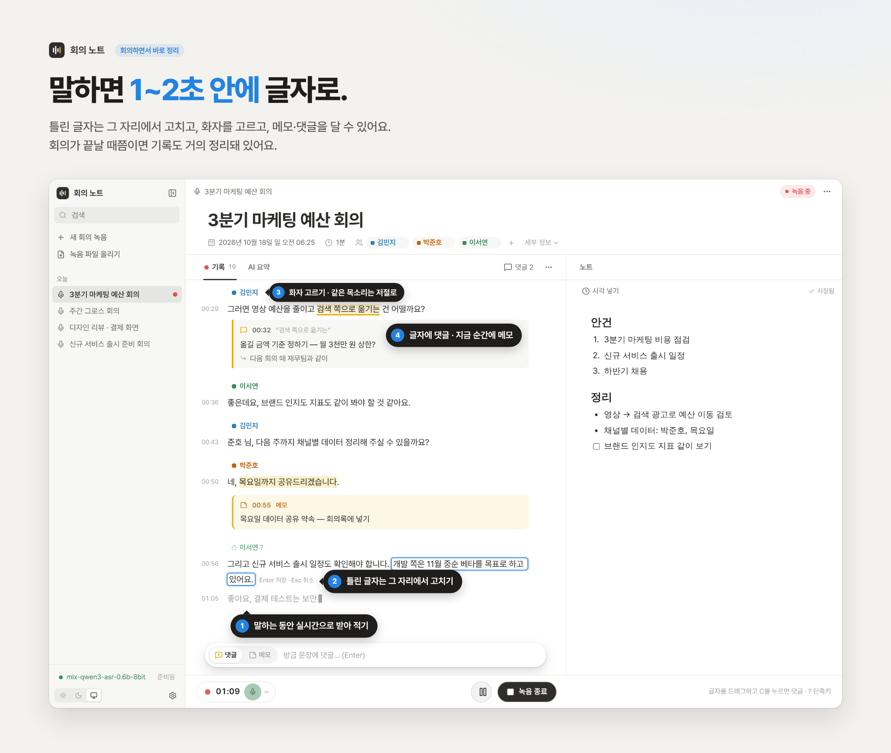
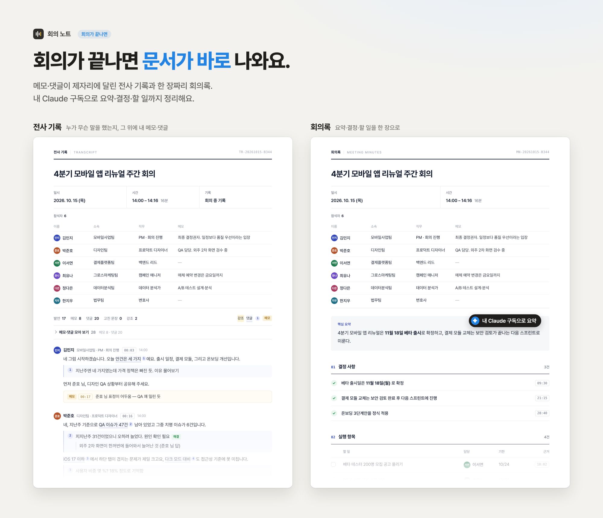
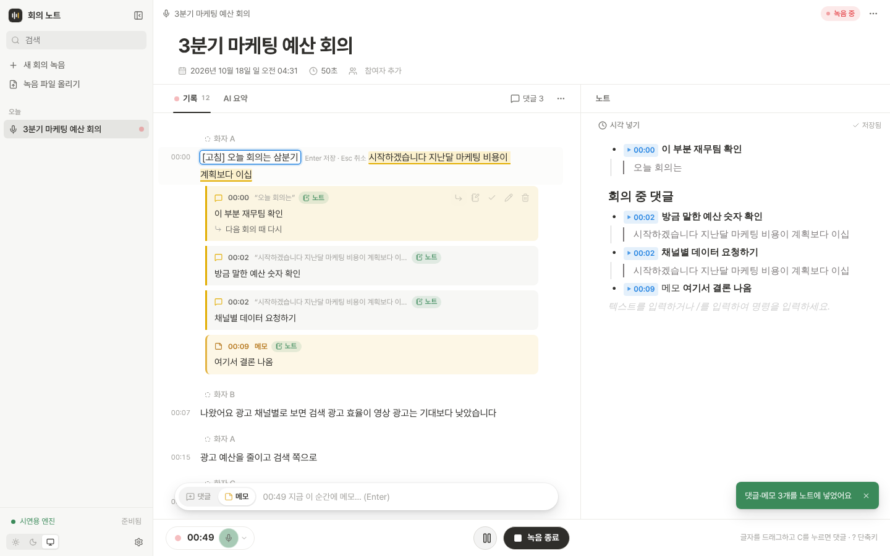
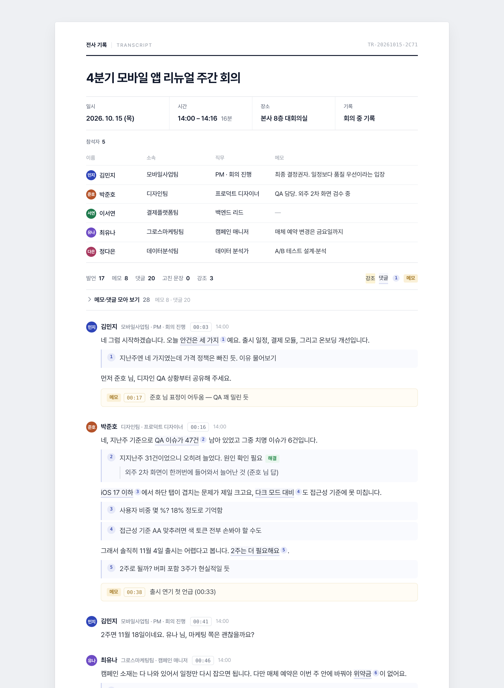
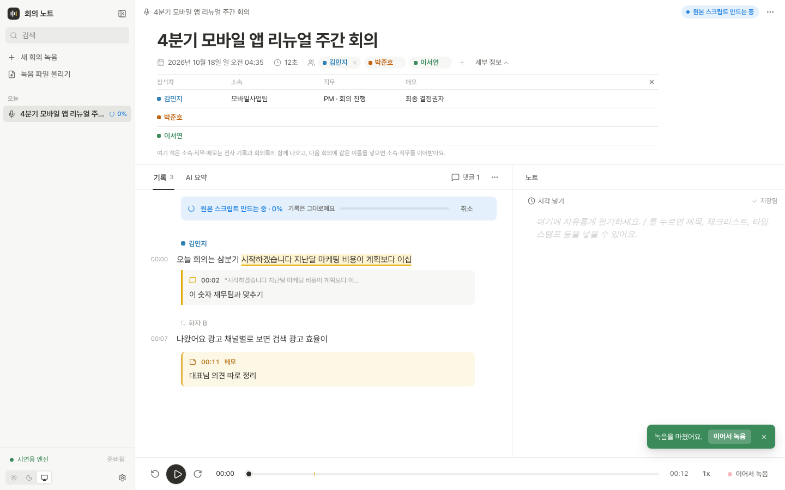
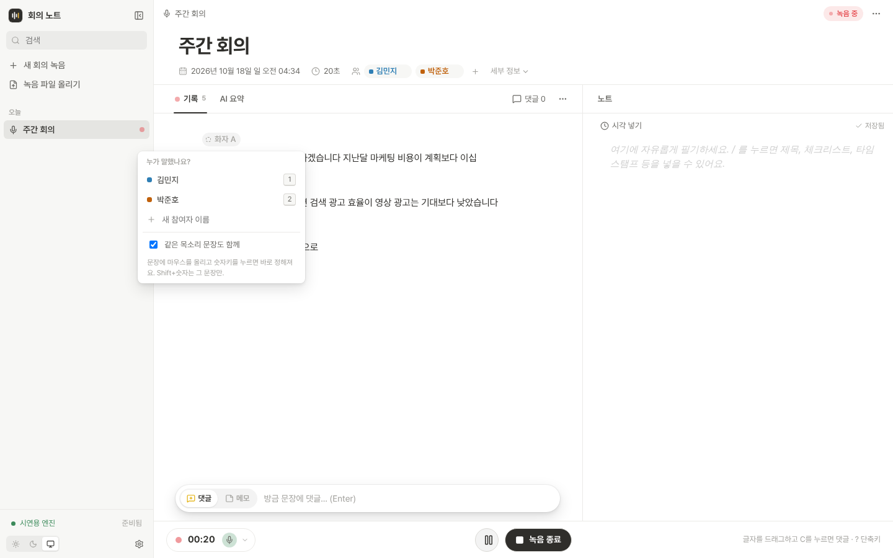
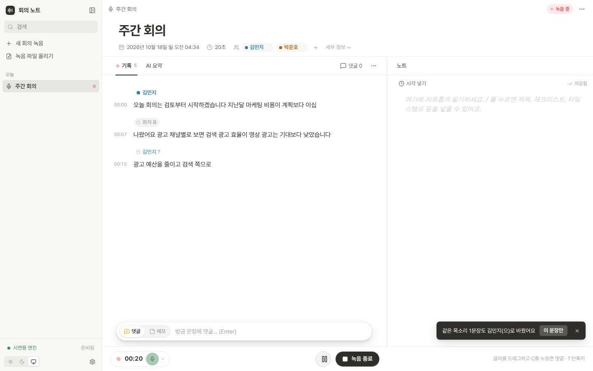

# 회의 노트 (Meeting Scribe)

맥북 안에서만 돌아가는 회의 기록 앱입니다. 듣는 동안 글자가 올라오고, 그 위에 내 생각을 남기고, 끝나면 문서 한 장이 나옵니다.



- 회의 소리가 **실시간으로 글자**가 되어 올라옵니다. 틀린 글자는 **그 자리에서 바로 고칩니다.** 녹음 중에도 됩니다.
- 그 위에 **댓글·메모·강조**를 남깁니다. 댓글은 문장 바로 아래에 대화처럼 보입니다.
- **누가 말했는지**도 보입니다. 비슷한 목소리끼리 "화자 A, B"로 묶이고, 미리 넣어 둔 참석자를 한 번 고르면(칩 클릭 또는 숫자키) 같은 목소리 문장 전체에 반영됩니다.
- 오른쪽 **노트**에 노션처럼 필기하고, 댓글을 노트로 보낼 수 있습니다.
- 끝나면 **전사 기록**(통화 기록처럼 화자별 발언 + 메모·댓글)과 **회의록**(요약·결정·할 일) 문서를 열고, 인쇄하거나 파일로 받습니다.
- 요약은 내가 구독한 **Claude가 MCP로 읽고** 만들어 앱에 저장합니다.
- 녹음을 마치면 더 큰 모델이 처음부터 다시 받아 적은 **원본 스크립트**를 참고용으로 따로 만듭니다. 회의 기록과는 섞지 않습니다. 회의를 방해하지 않게 녹음하지 않을 때만 만들고(기본은 전원이 연결돼 있을 때만, 설정에서 배터리로도 만들게 할 수 있음), 다음 녹음을 시작하면 잠시 멈춥니다.



<sub>화면 속 회의 내용과 이름은 예시입니다.</sub>

**만드는 기준**

1. 사람이 회의 중에 보고 고친 것이 기록이다. 기계가 나중에 덮어쓰거나 옮겨 붙이지 않는다.
2. 기록은 하나이고, 문서는 그 기록에서 바로 나온다. 후처리 결과는 참고용으로 옆에 둘 뿐이다.
3. 회의 중 손은 한 번만 쓴다. 클릭 하나, 키 하나로 되고, 안 쓰는 기능은 보이지 않는다.

| 기록 위 댓글·메모 + 노트 | 틀린 글자는 그 자리에서 고치기 (E) |
|---|---|
|  |  |

| 전사 기록 문서 | 참석자 소속·직무·메모 |
|---|---|
|  |  |

## 설치 (Apple Silicon 맥 · 윈도우 10/11)

**맥 앱 (권장)** Apple Silicon(M1 이상), macOS 13 이상. 터미널이나 Homebrew 없이 됩니다.

1. [Releases](https://github.com/jhkim0602/meeting-scribe/releases)에서 `MeetingScribe_…_mac-arm64.dmg`를 받아 열고, **회의 노트**를 응용 프로그램 폴더로 끌어다 놓습니다. (릴리스가 없으면 [Actions → 맥 앱](https://github.com/jhkim0602/meeting-scribe/actions/workflows/mac-app.yml)의 마지막 성공한 실행에서 Artifacts를 받습니다. GitHub 로그인이 필요합니다.)
2. 응용 프로그램 폴더에서 엽니다. 서명하지 않은 앱이라 처음 한 번은 "열 수 없습니다"가 뜹니다. **시스템 설정 → 개인정보 보호 및 보안** 맨 아래에서 **그래도 열기**를 누르고 다시 엽니다.
3. 설치 도우미가 이 맥의 메모리에 맞는 받아쓰기 모델을 골라 둡니다. 저장 위치, 화자 구분 토큰(선택), Claude 데스크톱 연결, 로그인할 때 켜기를 정하면 파이썬·패키지·모델을 받습니다. 처음 한 번, 10분 안팎(메모리 16GB 이상 맥의 기본 선택으로 약 6GB)입니다.
4. **회의 노트 열기**를 누르면 브라우저에서 회의 화면이 열립니다. 창을 닫아도 앱은 메뉴 막대에 남아 서버를 켜 둡니다. 모델·저장 위치 바꾸기, 점검, 끄기는 메뉴 막대 아이콘에서 합니다.

- 화자 구분 토큰은 [모델 페이지](https://huggingface.co/pyannote/speaker-diarization-community-1)에서 약관에 동의한 뒤 [토큰 페이지](https://huggingface.co/settings/tokens)에서 Read 토큰을 만들어 넣습니다. 없어도 받아쓰기는 되고, 화자만 나뉘지 않습니다.
- 파이썬·패키지·설정은 `~/Library/Application Support/com.meetingscribe.app`, 모델은 `~/.cache/huggingface`, 회의는 고른 저장 위치(기본 `~/MeetingScribe`)에 있습니다. 앱을 지우고 새로 받아도 회의와 받은 모델은 그대로이고, 터미널로 설치하며 받은 모델도 그대로 씁니다.
- "그래도 열기"가 보이지 않으면 터미널에서 `xattr -dr com.apple.quarantine "/Applications/회의 노트.app"`를 한 번 실행해도 됩니다.

**윈도우 앱** 윈도우 10/11 64비트. 받아쓰기는 CPU로 돌아가서 맥보다 조금 느립니다 (실시간 Whisper small, 녹음 후 정리 Whisper large-v3 turbo).

1. [Releases](https://github.com/jhkim0602/meeting-scribe/releases/latest)에서 `MeetingScribe_…_windows-x64-setup.exe`를 받아 실행합니다.
2. 서명하지 않은 앱이라 "Windows의 PC 보호" 창이 뜨면 **추가 정보 → 실행**을 누릅니다 (처음 한 번). 백신이 설치를 막으면 Windows 보안에서 허용합니다.
3. 맥과 같은 설치 도우미가 이어집니다. 회의 화면은 브라우저에서 열리고, 앱은 작업 표시줄 오른쪽 아래 아이콘에 남습니다.

**업데이트와 지우기 (맥·윈도우 같음)**

- 앱을 켤 때마다 새 버전을 확인합니다. 있으면 바뀐 점을 보여 주고 **나중에** / **지금 업데이트**를 묻습니다. 지금 업데이트를 누르면 받고, 바꾸고, 다시 켭니다(녹음 중에는 하지 않음). 회의 기록과 받은 모델은 그대로라 릴리스 페이지에서 다시 받을 필요가 없습니다.
- 설치·설정 창 → **저장 공간·지우기**: 받은 모델마다 크기를 보고 하나씩 지우거나 설치 캐시를 비웁니다. **회의 노트 완전히 지우기**는 앱·모델·파이썬·설정을 한 번에 지우고, 회의 기록은 남기거나 휴지통으로 옮길지 고릅니다. 모델은 회의 노트 목록에 있는 것만 지우고(다른 모델은 그대로), 회의 기록은 저장 폴더 안에서도 앱이 만든 것(scribe.db, meetings 등)만 옮겨서 같은 폴더의 다른 파일은 남습니다.
- 완전히 지우기를 해도 **회의 기록(전사 기록·회의록 HTML, 녹음 파일, 노트)은 고르지 않으면 그대로 남습니다.** 그래도 지우기 전에 회의 노트의 설정 → 전체 백업 내려받기(또는 지우기 창의 "전체 백업 받기")로 백업해 두세요.
- **모델을 직접 지우려면:** 모델은 Hugging Face 공용 폴더에 있습니다. 맥은 Finder → 이동 → 폴더로 이동(⇧⌘G)에 `~/.cache/huggingface/hub`, 윈도우는 파일 탐색기 주소창에 `%USERPROFILE%\.cache\huggingface\hub`를 넣습니다. `models--만든곳--모델이름` 폴더 하나가 모델 하나입니다(예: `models--moona3k--mlx-qwen3-asr-0.6b-8bit`). 회의 노트가 받는 것은 `moona3k`, `Qwen`, `mlx-community`, `Systran`, `mobiuslabsgmbh`, `pyannote`로 시작하는 폴더이고, 다른 이름은 다른 프로그램 것이니 두세요. 앱의 [지우기]를 쓰면 여러 모델이 같이 쓰는 큰 파일까지 정리해 더 깔끔합니다.

**터미널로 (개발용)**

```bash
./setup_mac.sh      # Python 3.12 가상환경(ffmpeg 포함), Qwen3-ASR(MLX) 설치 + 모델 미리 받기(선택)
./run.sh            # http://127.0.0.1:8765 이 열립니다
```

- 로그인할 때 서버를 저절로 켜려면 `scripts/launchagent.sh install` (끄기: `uninstall`).
- 화자 구분 토큰은 `.env`의 `HF_TOKEN=`에 붙여 넣습니다.
- 처음 맥에서 쓸 때는 `cd backend && .venv/bin/python -m scribe.selftest --compare`로 속도와 정확도를 확인하고, [맥 점검표](docs/MAC_CHECKLIST.md)를 한 번 따라 해 보세요.

## 쓰는 법

| 하고 싶은 것 | 방법 |
|---|---|
| 녹음 시작 | 왼쪽 "새 회의 녹음" 또는 아래 빨간 버튼. 옆의 마이크 이름을 누르면 마이크를 고르고 소리가 잘 들어오는지 막대로 확인할 수 있습니다 |
| 녹음 상태 보기 | 아래 녹음 표시줄(● 시간 🎙)을 누르면 마이크 바꾸기, 입력 막대, 받아쓰기·연결·저장 공간 상태가 나옵니다 |
| **틀린 글자 고치기** | 문장에 마우스를 올려 연필을 누르거나 **E**. 글자를 고르고 "고치기"를 누르면 고른 부분이 선택된 채로 열립니다. Enter 저장, Esc 취소. 고친 문장은 옅은 점선이 생기고, 마우스를 올리면 처음 받아 적은 글이 보입니다. 고칠 때 "처음 받아 적은 대로"로 되돌릴 수 있습니다 |
| 방금 들은 문장에 댓글 | 녹음 중 화면 아래 입력창(기본이 "댓글")에 쓰고 Enter |
| 지금 순간에 메모 | 아래 입력창을 "메모"로 바꾸고 Enter (Tab으로 전환) |
| 글자 일부에 댓글 | 기록에서 글자를 드래그 → **C** 키 (또는 ⌘⌥M, 떠오르는 "댓글" 버튼) |
| 문장 전체에 댓글 | 문장에 마우스를 올리면 오른쪽에 뜨는 댓글 버튼 |
| 답글·해결·편집 | 댓글에 마우스를 올리면 오른쪽에 버튼이 나타납니다 |
| 강조 | 드래그 → "강조" (색은 눌러서 바꾸기) |
| 댓글을 노트로 | 댓글의 노트 버튼, 또는 위 "댓글 n" → "아직 안 보낸 n개 노트로". 댓글 입력창의 "노트에도 추가"를 켜 두면 달 때 바로 들어갑니다 |
| 기록을 노트로 인용 | 드래그 → "노트로" |
| 노트에 시각 넣기 | 노트 위 "시각 넣기" 또는 `/타임스탬프` |
| 참석자 미리 넣기 | 제목 아래 "참여자 추가" → 이름을 쓰고 Enter (쉼표로 여러 명). 지난 회의 참석자와 목소리를 기억하는 사람은 눌러서 바로 |
| 참석자 정보 | 참석자 이름을 누르거나 "세부 정보": 사람마다 소속·직무·메모. 문서에 함께 나오고, 다음 회의에 같은 이름이면 소속·직무를 이어받습니다 |
| 화자 고르기 | 단락 위 "화자 A"를 눌러 참석자 선택 → 같은 목소리 문장(지난 것, 앞으로 올 것)에 모두 반영. 문장에 마우스를 올리고 숫자키 1·2·3…로도 됩니다. 녹음 중에는 마우스를 올리지 않아도 방금 문장에 적용돼요 |
| 그 문장만 바꾸기 | Shift+숫자키, 또는 문장 위 사람 아이콘. 같은 목소리에 반영된 뒤 뜨는 "이 문장만"을 눌러도 됩니다 |
| 화자 표시 읽는 법 | 진한 이름 = 직접 고름, 흐린 이름과 ? = 목소리로 추정, 회색 "화자 A" = 아직 누군지 모름 |
| 파일 처리 | 왼쪽 "녹음 파일 올리기" 또는 첫 화면에 끌어다 놓기. 큰 모델이 10분씩 받아 적는 대로 회의 기록에 바로 나타나서, 다 끝나기 전에도 읽고 고칠 수 있습니다. 다 받아 적으면 화자가 "화자 A, B"로 묶여 녹음한 회의처럼 칩이나 숫자키로 고릅니다 |
| 전사 기록 | 오른쪽 위 ⋯ → 전사 기록 보기: 통화 기록처럼 화자별 발언, 그 아래 메모·댓글. 위쪽 줄에서 회의록으로 전환, 인쇄·PDF, 파일로 받기 |
| 문서 고치기 | 앱에서 연 전사 기록·회의록은 위쪽 **[고치기]**로 문장·메모·댓글·참석자를 고치면 회의 기록에 바로 저장됩니다. **파일로 받은 HTML**은 오른쪽 아래 [고치기] → 글자를 **더블클릭**해 고치고 Enter → [저장]으로 고친 파일을 새로 저장합니다(크롬·엣지는 저장할 곳·이름을 고름). 받은 파일에서 고친 것은 **그 파일만 바뀌고 앱의 회의 기록에는 반영되지 않습니다** |
| 폴더로 정리 | 왼쪽 '폴더'의 + 로 폴더를 만들고, 회의를 폴더로 끌어다 놓거나 오른쪽 클릭(맥: 두 손가락 클릭)으로 옮깁니다. 폴더 이름은 두 번 눌러 바꾸고, 폴더 안에 폴더를 3단계까지 둘 수 있습니다. 폴더를 지워도 회의는 남습니다. 저장 폴더에서도 `meetings/폴더/날짜_제목`으로 정리되고, 녹음·작업 중이거나(윈도우) 다른 프로그램이 파일을 열고 있으면 끝난 뒤 옮깁니다. 자세한 것은 '폴더' 옆 ? |
| 회의록 | 오른쪽 위 ⋯ → 회의록 보기: 정보·요약·할 일·노트·메모를 한 장으로 |
| 원본 스크립트 | 오른쪽 위 ⋯ → 원본 스크립트 받기 (.md): 녹음을 마친 뒤 큰 모델로 다시 받아 적고 화자를 나눈 참고용 기록. 회의 기록과 메모·댓글은 바뀌지 않습니다. 전원이 연결돼 있고 녹음하지 않을 때 저절로 만들고(배터리면 "전원을 연결하면 만들어요", 설정에서 "배터리로 쓸 때도 만들기"를 켜면 배터리여도), 기다리지 않으려면 ⋯ → 지금 만들기. 설정에서 저절로 만들기를 끄면 ⋯ → 원본 스크립트 만들기를 누를 때만 만듭니다 |
| 내보내기 | 오른쪽 위 ⋯ → Markdown으로 내보내기 |
| 보기 바꾸기 | 기록 탭 오른쪽 ⋯ → 메모·댓글 보기, 댓글 한 줄로 접기, 실제 시각으로 보기, 글자 크기 |
| 실제 시각 | 시간(00:12:30)에 마우스를 올리면 그 말을 한 실제 시각(오후 2:15:30)이 보입니다 |
| 지우기 | 확인창 없이 바로 지워지고, 몇 초 동안 "되돌리기"가 뜹니다 (회의는 10초) |
| 새 문장 따라가기 | 녹음 중에는 맨 아래를 따라갑니다. 위로 스크롤해 읽는 동안은 멈추고 "새 문장 n개" 버튼이 뜹니다. 재생 중에도 다른 곳을 보면 "재생 위치로" 버튼이 뜹니다 |

| 단축키 | 하는 일 |
|---|---|
| ⌘⇧P | 녹음 일시정지 / 이어하기 |
| E | 마우스를 올린 문장(녹음 중이면 방금 문장)을 그 자리에서 고치기 |
| C | 고른 글자에 댓글 (녹음 중 고른 글자가 없으면 방금 문장에 댓글) |
| M | 지금 시각에 메모 |
| 1 … 9 | 문장의 화자를 그 번호의 참석자로 (같은 목소리 문장도 함께) |
| ⇧ 1 … 9 | 그 문장만 |
| ⌘F | 기록에서 찾기 |
| ? | 단축키 목록 |

노트로 보낸 댓글에는 "노트" 표시가 붙고, 일괄 내보내기는 아직 보내지 않은 것만 넣어 중복이 생기지 않습니다. 노트에는 이렇게 들어갑니다.

```
• ▶02:05 재무팀 확인 필요
    │ 지난달 마케팅 비용이 계획보다 20% 넘게 나왔어요   ← 댓글 단 글자
    • 답글: 다음 주에 다시 확인
```

일시정지 후 이어서 녹음하거나, 끝난 회의에 "이어서 녹음"을 눌러 같은 파일 뒤에 덧붙일 수 있습니다.

## 회의 중 예외 처리

알림은 "조용한 비서"처럼 세 단계로만 합니다. 소리는 내지 않습니다.

| 단계 | 언제 | 어떻게 |
|---|---|---|
| 아이콘 | 마이크 다시 연결 중, 마이크 음소거·무음 30초, 서버 재연결 15초 미만 | 녹음 표시줄의 작은 아이콘만 주황색으로 바뀝니다 |
| 한 번 알림 | "쉬는 시간인가요?", 일시정지 중 말소리 | 위쪽에 한 번 뜨고 15초 뒤 표시줄의 작은 버튼(또는 점)으로 접힙니다. 마우스를 올려 두면 기다립니다 |
| 계속 알림 | 마이크 재연결 실패, 무음 1분, 서버 15초 넘게 끊김, 저장 공간 1시간 미만 | 해결될 때까지 남습니다 |

| 상황 | 동작 |
|---|---|
| 쉬는 시간 | 일시정지 후 다시 시작하면 "쉬는 시간 · 14:02–14:15 · 13분" 구분선이 생깁니다. 20초보다 짧게 멈춘 것은 남기지 않습니다 |
| 구분선 직접 넣기 | 문장에 마우스를 올리면 오른쪽 구분선 버튼. 이름(예: 2부, 안건 2)을 붙이거나 선만 넣을 수 있고, 두 번 눌러 이름을 바꿉니다 |
| 말을 잠깐 멈췄다 이어 말함 | 받아 적은 글이 말끝(…다/…요/마침표)이 아니면 1.1초까지 기다렸다 문장을 자릅니다. 그래도 나뉜 문장은 같은 사람이면 한 단락으로 이어 보여 주고, 진행 중 글자도 그 단락 끝에 이어 붙습니다 |
| 일시정지 중 말소리 | 마이크는 계속 듣습니다. 일시정지하고 30초가 지난 뒤 말소리가 들리면 그 일시정지 동안 한 번만 알리고, 이후로는 표시줄에 점만 남깁니다 |
| 오래 조용함 | 기본 3분 동안 말소리가 없으면 "쉬는 시간인가요?"를 묻습니다. "네"를 누르면 조용해진 시점부터 쉬는 시간으로 표시합니다. 설정에서 시간을 바꾸거나 끌 수 있습니다 |
| 녹음 종료 | 확인창이 뜹니다 (일시정지 / 계속 녹음 / 녹음 종료). 종료 후 10초 동안 "이어서 녹음" 알림이 남고, 원본 스크립트를 만드는 중이어도 이어서 녹음하면 그 작업을 취소하고 같은 파일에 이어 붙입니다 |
| 마이크가 빠짐 | 같은 마이크, 안 되면 기본 마이크로 조용히 다시 연결합니다. 실패하면 일시정지하고 알려 줍니다 |
| 마이크에서 소리가 안 들어옴 | 다른 앱이 마이크를 가져가 음소거되거나 완전히 0인 소리가 30초 이어지면 아이콘, 1분이면 경고. 조용한 회의실의 작은 잡음은 경고하지 않습니다 |
| 서버 연결 끊김 | 소리를 브라우저에 최대 30분 모아 두고, 다시 연결되면 이어서 보냅니다. 끊김은 쉬는 시간으로 치지 않습니다 |
| 노트북 잠자기 | 녹음하는 동안 맥이 저절로 잠들지 않게 합니다 (caffeinate, 화면은 꺼져도 됨). 덮개를 닫아 재웠다면 깨어난 뒤 잠든 동안을 쉬는 시간 구분선으로 남깁니다 |
| 탭을 닫음 | 녹음 중이면 브라우저가 한 번 더 묻습니다. 닫아도 그때까지 녹음은 저장되고, 다시 열어 "이어서 녹음"하면 그 사이가 쉬는 시간으로 남습니다 |
| 저장 공간 | 녹음을 시작할 때 1시간 분량보다 적으면 알립니다. 녹음 중 바닥나면 여기까지 저장하고 멈춥니다 (파일이 깨지지 않음) |
| 블루투스 마이크 | 에어팟 등을 고르면 "통화 음질로 바뀌어 부정확할 수 있어요" 한 줄을 보여 줍니다 |

이 앱은 이 컴퓨터(127.0.0.1)에서만 열립니다. 다른 사이트의 페이지가 브라우저를 통해 API나 녹음 연결을 쓰는 것은 막혀 있습니다.

| 쉬는 시간·직접 넣은 구분선 | 종료 확인창 |
|---|---|
|  |  |

| 회의 중 화자 고르기 (참석자 · 숫자키) | 한 번 고르면 같은 목소리 문장에도 |
|---|---|
|  |  |

| 녹음 표시줄을 누르면 (마이크·상태) | ⋯ 보기 설정 | ⌘F 기록에서 찾기 |
|---|---|---|
|  |  |  |

## Claude로 요약하기 (MCP + 스킬)

앱은 회의 데이터를 MCP 서버로 내어 줍니다. 내 Claude 구독으로 요약하고, 결과를 앱에 저장합니다.

**Claude Code**
```bash
claude mcp add meeting-scribe -- /경로/meeting-scribe/scripts/mcp.sh
mkdir -p ~/.claude/skills && cp -r claude/skills/meeting-minutes ~/.claude/skills/
```

**Claude Desktop**: 설정 → 개발자 → 구성 편집에서 아래를 추가하고 재시작합니다.
```json
{ "mcpServers": { "meeting-scribe": { "command": "/경로/meeting-scribe/scripts/mcp.sh" } } }
```
회의록 스킬은 `claude/skills/meeting-minutes` 폴더를 zip으로 묶어 설정 → 기능 → 스킬에서 올립니다.

그다음 Claude에게 "방금 회의 회의록으로 정리해줘"라고 말하면 됩니다.

| MCP 도구 | 하는 일 |
|---|---|
| `list_meetings` / `search_meetings` | 회의 목록, 전체 검색 |
| `get_meeting_bundle` | 노트 + 메모·댓글 + 회의 기록을 한 번에 (요약용, 긴 회의는 이어 읽기 안내) |
| `get_transcript` / `get_notes` / `get_annotations` | 부분만 읽기 |
| `get_reference_script` | 참고용 원본 스크립트 (기록에서 알아듣기 어려운 부분 확인용) |
| `save_summary` | 요약을 앱의 "AI 요약" 탭에 저장 |

`meeting_id` 자리에 `latest`를 쓰면 가장 최근 회의입니다.

## 알려진 제한

- 회의 중 화자는 문장마다 목소리 특징을 비교한 **추정**입니다. 짧은 대답("네")이나 겹쳐 말한 부분은 틀릴 수 있어 직접 고르기를 함께 둡니다. 목소리 특징은 pyannote(`[diarize]` 설치)가 있을 때만 뽑고, 없으면 바로 앞 문장의 화자를 이어받는 정도만 합니다.
- 원본 스크립트의 화자 구분은 5명 이상이거나 여러 명이 동시에 말할 때 정확도가 떨어집니다.
- 실제 MLX 엔진 코드는 패키지 API(mlx-qwen3-asr 0.4.4)에 맞춰 작성했지만, 개발 환경이 리눅스라 맥 실기기 실행은 아직 확인하지 않았습니다. [맥 점검표](docs/MAC_CHECKLIST.md)대로 확인해 주시고, 문제가 있으면 `~/MeetingScribe/meetings/<회의ID>/worker.log`와 `~/MeetingScribe/server.log`(앱으로 설치했다면 `~/Library/Application Support/com.meetingscribe.app/logs/`)를 봐 주세요.
- 8bit 모델은 패키지 제작자가 영어로 검증한 것입니다. 한국어 정확도는 `selftest --compare`로 확인하세요.
- 앱은 Apple 개발자 서명·공증 없이 만듭니다(나·팀 안에서 쓰는 용도). 처음 열 때 한 번 "그래도 열기"가 필요합니다.
- 녹음 동의는 참석자에게 꼭 받아 주세요.

## 더 보기

- [사용자 시나리오](docs/USER_SCENARIOS.md): 무엇을 왜 만들었는지
- [개발 문서](docs/DEVELOPMENT.md): 구조, 성능, 설정, 테스트
- [맥 점검표](docs/MAC_CHECKLIST.md): 처음 맥에서 확인할 것
