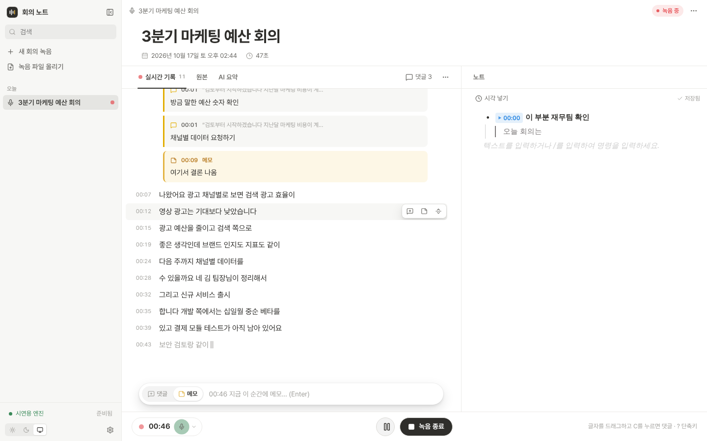
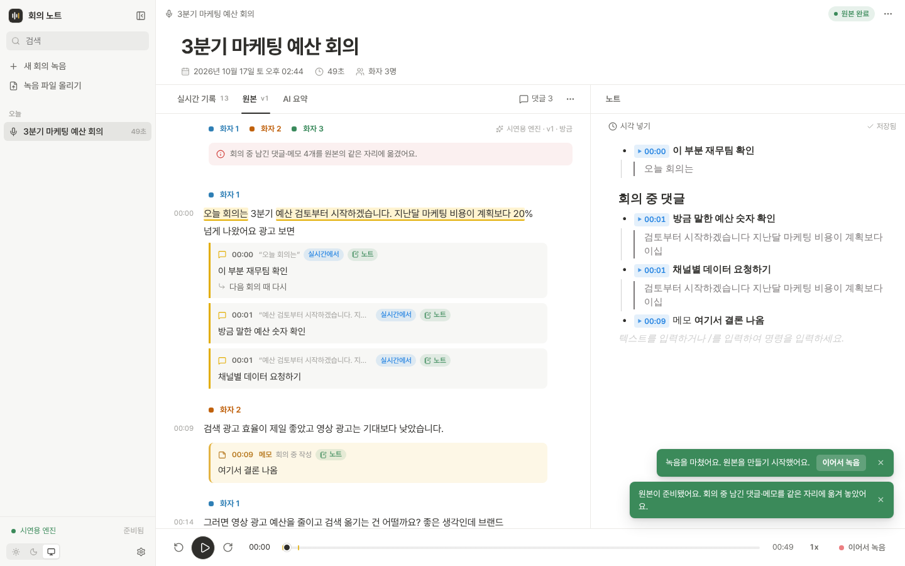
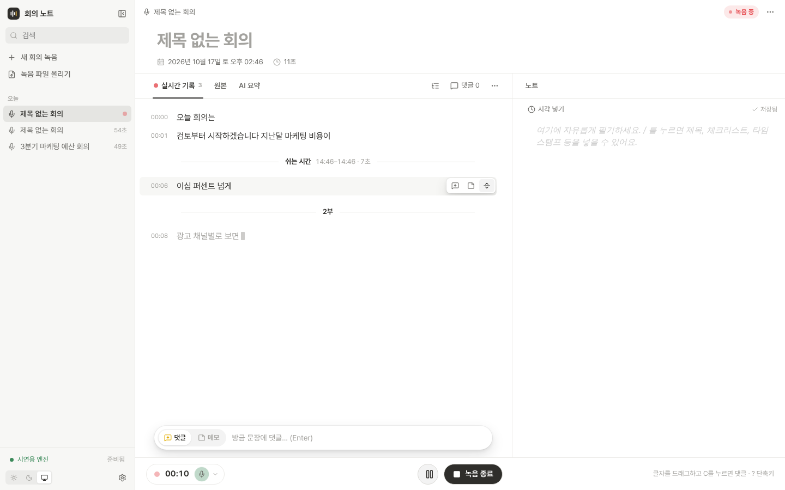
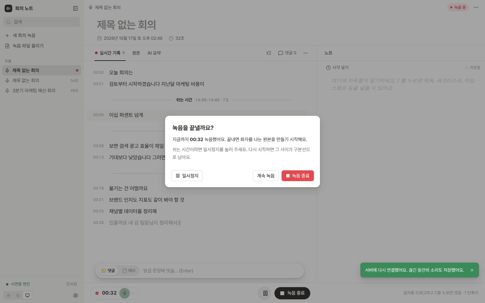
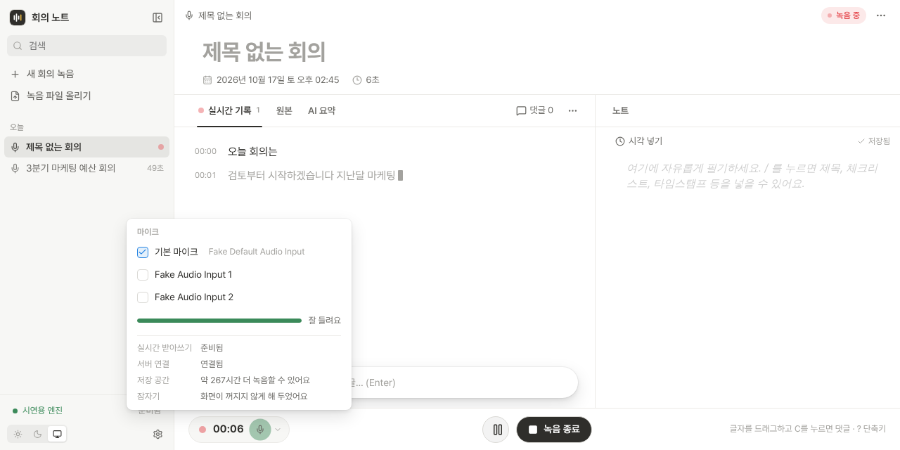
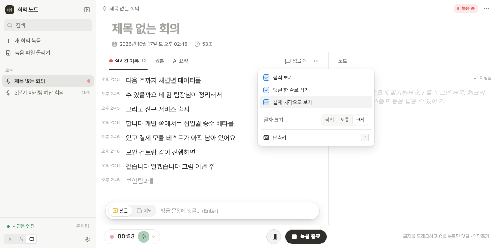
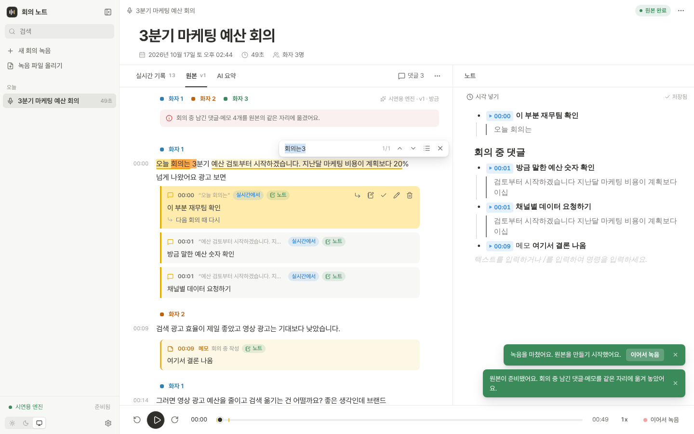

# 회의 노트 (Meeting Scribe)

맥북 안에서만 돌아가는 **클로바노트 + 노션**입니다.

- 왼쪽에는 회의 소리가 실시간으로 글자가 되어 올라옵니다. 그 위에 바로 **댓글**을 답니다. 댓글은 문장 바로 아래에 대화처럼 보입니다.
- 댓글은 하나씩 또는 한 번에 오른쪽 **노트로 내보낼** 수 있습니다. 노트에는 시각, 댓글, 원문 인용이 함께 들어갑니다.
- 오른쪽 노트는 노션처럼 자유롭게 **필기**합니다. 타임스탬프를 누르면 그 시점을 다시 들을 수 있습니다.
- 녹음을 마치면 더 큰 모델이 처음부터 다시 받아 적고 **화자를 나눈 원본**을 만듭니다. 회의 중 단 댓글·메모·수정은 원본의 **같은 자리에** 다시 표시됩니다.
- 쉬는 시간은 일시정지로 처리하고, 다시 시작하면 그 사이가 **쉬는 시간 구분선**으로 남습니다. 마이크·서버가 끊겨도 녹음이 이어집니다.
- 3~5시간짜리 녹음 파일도 끌어다 놓으면 같은 화면으로 처리합니다.
- 요약은 내가 구독한 **Claude가 MCP로 읽고** 만들어 앱의 "AI 요약" 탭에 저장합니다.

| 실시간 기록 위 댓글 + 노트 | 원본(화자 구분)으로 옮겨진 댓글 |
|---|---|
|  |  |

## 빠른 시작 (Apple Silicon 맥)

```bash
./setup_mac.sh      # ffmpeg, Python 3.12, Qwen3-ASR(MLX) 설치 + 모델 미리 받기(선택, 약 4.7GB)
./run.sh            # http://127.0.0.1:8765 이 열립니다
```

- 로그인할 때 서버를 저절로 켜려면 `scripts/launchagent.sh install` (끄기: `uninstall`). 터미널을 열어 둘 필요가 없습니다.
- 처음 맥에서 쓸 때는 `cd backend && .venv/bin/python -m scribe.selftest --compare`로 속도와 정확도를 확인하고, [맥 점검표](docs/MAC_CHECKLIST.md)를 한 번 따라 해 보세요.

화자 구분까지 쓰려면 한 번만 준비합니다.

1. https://huggingface.co/pyannote/speaker-diarization-community-1 에서 약관에 동의합니다.
2. https://huggingface.co/settings/tokens 에서 Read 토큰을 만들어 `.env`의 `HF_TOKEN=`에 붙여 넣습니다.

토큰이 없어도 전사는 되고, 원본에서 화자만 나뉘지 않습니다.

## 쓰는 법

| 하고 싶은 것 | 방법 |
|---|---|
| 녹음 시작 | 왼쪽 "새 회의 녹음" 또는 아래 빨간 버튼. 옆의 마이크 이름을 누르면 마이크를 고르고 소리가 잘 들어오는지 막대로 확인할 수 있습니다 |
| 녹음 상태 보기 | 아래 녹음 표시줄(● 시간 🎙)을 누르면 마이크 바꾸기, 입력 막대, 받아쓰기·연결·저장 공간 상태가 나옵니다. 마이크 아이콘은 소리가 들어오면 은은하게 빛납니다 |
| 방금 들은 문장에 댓글 | 녹음 중 화면 아래 입력창(기본이 "댓글")에 쓰고 Enter |
| 지금 순간에 메모 | 아래 입력창을 "메모"로 바꾸고 Enter (Tab으로 전환) |
| 글자 일부에 댓글 | 기록에서 글자를 드래그 → **C** 키 (또는 ⌘⌥M, 떠오르는 "댓글" 버튼) |
| 문장 전체에 댓글 | 문장에 마우스를 올리면 오른쪽에 뜨는 댓글 버튼 |
| 답글·해결·편집 | 댓글에 마우스를 올리면 오른쪽에 버튼이 나타납니다 |
| 댓글을 노트로 | 댓글의 노트 버튼, 또는 위 "댓글 n" → "아직 안 보낸 n개 노트로" |
| 댓글 달 때 바로 노트에도 | 댓글 입력창의 "노트에도 추가" 체크 (다음에도 기억) |
| 강조·수정 | 드래그 → "강조" / "수정" |
| 기록을 노트로 인용 | 드래그 → "노트로" |
| 노트에 시각 넣기 | 노트 위 "시각 넣기" 또는 `/타임스탬프` |
| 원본 보기 | "원본" 탭. 녹음을 끝내면 자동으로 만들어집니다 |
| 고친 내용을 원본에 반영 | 원본의 빨간 수정 표시를 눌러 "원본에 적용" 또는 "무시" |
| 화자 이름 바꾸기 | 원본의 "화자 1"을 눌러 이름 입력 |
| 파일 처리 | 왼쪽 "녹음 파일 올리기" 또는 첫 화면에 끌어다 놓기 |
| 내보내기 | 오른쪽 위 ⋯ → Markdown으로 내보내기 |
| 보기 바꾸기 | 기록 탭 오른쪽 ⋯ → 첨삭 보기, 댓글 한 줄로 접기, 실제 시각으로 보기, 글자 크기 |
| 실제 시각 | 시간(00:12:30)에 마우스를 올리면 그 말을 한 실제 시각(오후 2:15:30)이 보입니다 |
| 지우기 | 확인창 없이 바로 지워지고, 몇 초 동안 "되돌리기"가 뜹니다 (회의는 10초) |
| 새 문장 따라가기 | 녹음 중에는 맨 아래를 따라갑니다. 위로 스크롤해 읽는 동안은 멈추고 "새 문장 n개" 버튼이 뜹니다. 재생 중에도 다른 곳을 보면 "재생 위치로" 버튼이 뜹니다 |

| 단축키 | 하는 일 |
|---|---|
| ⌘⇧P | 녹음 일시정지 / 이어하기 |
| C | 고른 글자에 댓글 (녹음 중 고른 글자가 없으면 방금 문장에 댓글) |
| M | 지금 시각에 메모 |
| ⌘F | 기록에서 찾기 |
| ? | 단축키 목록 |

노트로 보낸 댓글에는 "노트" 표시가 붙고, 일괄 내보내기는 아직 보내지 않은 것만 넣어 중복이 생기지 않습니다. 노트에는 이렇게 들어갑니다.

```
• ▶02:05 재무팀 확인 필요
    │ 지난달 마케팅 비용이 계획보다 20% 넘게 나왔어요   ← 댓글 단 원문
    • 답글: 다음 주에 다시 확인
```

일시정지 후 이어서 녹음하거나, 끝난 회의에 "이어서 녹음"을 눌러 같은 파일 뒤에 덧붙일 수 있습니다.

## 회의 중 예외 처리

알림은 "조용한 비서"처럼 세 단계로만 합니다. 소리는 내지 않습니다.

| 단계 | 언제 | 어떻게 |
|---|---|---|
| 아이콘 | 마이크 다시 연결 중, 마이크 음소거·무음 30초, 서버 재연결 15초 미만 | 녹음 표시줄의 작은 아이콘만 주황색으로 바뀝니다 |
| 한 번 알림 | "쉬는 시간인가요?", 일시정지 중 말소리 | 위쪽에 한 번 뜨고 15초 뒤 표시줄의 작은 버튼(또는 점)으로 접힙니다. 마우스를 올려 두면 기다립니다 |
| 계속 알림 | 마이크 재연결 실패, 무음 1분, 서버 15초 넘게 끊김, 저장 공간 1시간 미만 | 해결될 때까지 남습니다 |

| 상황 | 동작 |
|---|---|
| 쉬는 시간 | 일시정지 후 다시 시작하면 "쉬는 시간 · 14:02–14:15 · 13분" 구분선이 생깁니다. 20초보다 짧게 멈춘 것은 남기지 않습니다. 원본에서도 이 경계를 넘어 문장을 합치지 않습니다 |
| 구분선 직접 넣기 | 문장에 마우스를 올리면 오른쪽 세 번째 버튼. 이름(예: 2부, 안건 2)을 붙이거나 선만 넣을 수 있고, 두 번 눌러 이름을 바꿉니다 |
| 일시정지 중 말소리 | 마이크는 계속 듣습니다. 일시정지하고 30초가 지난 뒤 말소리가 들리면 그 일시정지 동안 한 번만 알리고, 이후로는 표시줄에 점만 남깁니다 |
| 오래 조용함 | 기본 3분 동안 말소리가 없으면 "쉬는 시간인가요?"를 묻습니다. "네"를 누르면 조용해진 시점부터 쉬는 시간으로 표시합니다. 설정에서 시간을 바꾸거나 끌 수 있습니다 |
| 녹음 종료 | 확인창이 뜹니다 (일시정지 / 계속 녹음 / 녹음 종료). 종료 후 10초 동안 "이어서 녹음" 알림이 남고, 원본을 만드는 중이어도 이어서 녹음하면 그 작업을 취소하고 같은 파일에 이어 붙입니다 |
| 마이크가 빠짐 | 같은 마이크, 안 되면 기본 마이크로 조용히 다시 연결합니다. 실패하면 일시정지하고 알려 줍니다 |
| 마이크에서 소리가 안 들어옴 | 다른 앱이 마이크를 가져가 음소거되거나 완전히 0인 소리가 30초 이어지면 아이콘, 1분이면 경고. 조용한 회의실의 작은 잡음은 경고하지 않습니다 |
| 서버 연결 끊김 | 소리를 브라우저에 최대 30분 모아 두고, 다시 연결되면 이어서 보냅니다. 끊김은 쉬는 시간으로 치지 않습니다 |
| 노트북 잠자기 | 녹음하는 동안 맥이 저절로 잠들지 않게 합니다 (caffeinate, 화면은 꺼져도 됨). 덮개를 닫아 재웠다면 깨어난 뒤 잠든 동안을 쉬는 시간 구분선으로 남깁니다 |
| 탭을 닫음 | 녹음 중이면 브라우저가 한 번 더 묻습니다. 닫아도 그때까지 녹음은 저장되고, 다시 열어 "이어서 녹음"하면 그 사이가 쉬는 시간으로 남습니다 |
| 저장 공간 | 녹음을 시작할 때 1시간 분량보다 적으면 알립니다. 녹음 중 바닥나면 여기까지 저장하고 멈춥니다 (파일이 깨지지 않음) |
| 블루투스 마이크 | 에어팟 등을 고르면 "통화 음질로 바뀌어 부정확할 수 있어요" 한 줄을 보여 줍니다 |

이 앱은 이 컴퓨터(127.0.0.1)에서만 열립니다. 다른 사이트의 페이지가 브라우저를 통해 API나 녹음 연결을 쓰는 것은 막혀 있습니다.

| 쉬는 시간·직접 넣은 구분선 | 종료 확인창 |
|---|---|
|  |  |

| 녹음 표시줄을 누르면 (마이크·상태) | ⋯ 보기 설정 | ⌘F 기록에서 찾기 |
|---|---|---|
|  |  |  |

## Claude로 요약하기 (MCP + 스킬)

앱은 회의 데이터를 MCP 서버로 내어 줍니다. 내 Claude 구독으로 요약하고, 결과를 앱에 저장합니다.

**Claude Code**
```bash
claude mcp add meeting-scribe -- /경로/meeting-scribe/scripts/mcp.sh
mkdir -p ~/.claude/skills && cp -r claude/skills/meeting-minutes ~/.claude/skills/
```

**Claude Desktop**: 설정 → 개발자 → 구성 편집에서 아래를 추가하고 재시작합니다.
```json
{ "mcpServers": { "meeting-scribe": { "command": "/경로/meeting-scribe/scripts/mcp.sh" } } }
```
회의록 스킬은 `claude/skills/meeting-minutes` 폴더를 zip으로 묶어 설정 → 기능 → 스킬에서 올립니다.

그다음 Claude에게 "방금 회의 회의록으로 정리해줘"라고 말하면 됩니다.

| MCP 도구 | 하는 일 |
|---|---|
| `list_meetings` / `search_meetings` | 회의 목록, 전체 검색 |
| `get_meeting_bundle` | 노트 + 첨삭 + 전사를 한 번에 (요약용, 긴 회의는 이어 읽기 안내) |
| `get_transcript` / `get_notes` / `get_annotations` | 부분만 읽기 |
| `save_summary` | 요약을 앱의 "AI 요약" 탭에 저장 |
| `rename_speakers` | 화자 라벨에 이름 붙이기 |

`meeting_id` 자리에 `latest`를 쓰면 가장 최근 회의입니다.

## 어떻게 동작하나

```
브라우저 마이크 ──16kHz PCM──▶ FastAPI WebSocket ──▶ audio.wav (계속 이어 쓰기)
                                    │
                                    └─▶ 무음 기준 분할 → Qwen3-ASR-0.6B → 실시간 문장 (+진행 중 문장)
녹음 종료 ─▶ 별도 프로세스: Qwen3-ASR-1.7B + 단어 정렬 → pyannote 화자 구분 → 화자별 발화 = 원본
첨삭(메모/댓글/수정) ─▶ "오디오 시간 + 인용문"으로 저장 → 원본에서 시간 창 안의 가장 비슷한 문장에 다시 붙임
```

첨삭 위치를 글자 번호가 아니라 **오디오 시간과 인용문**으로 저장하는 것이 핵심입니다. 실시간 기록과 원본은 띄어쓰기, 숫자 표기, 문장 경계, 화자 분할이 모두 다르지만, 같은 시간대에서 인용문과 가장 비슷한 부분을 찾아 같은 자리에 표시합니다. 문장이 너무 달라 찾지 못하면 시간만으로 위치를 추정하고 "위치 추정" 표시를 붙입니다.

| 구성 | 기본값 | 바꾸는 법 (`.env`) |
|---|---|---|
| 실시간 받아쓰기 | Qwen3-ASR-0.6B (MLX) | `SCRIBE_LIVE_MODEL` |
| 원본 받아쓰기 | Qwen3-ASR-1.7B + ForcedAligner (MLX) | `SCRIBE_FINAL_MODEL` |
| 대안 엔진 | whisper-large-v3-turbo (mlx-whisper) | `SCRIBE_LIVE_ENGINE=whisper` |
| 화자 구분 | speakrs(설치 시) → pyannote community-1 | `SCRIBE_DIARIZER` |
| 데이터 | `~/MeetingScribe` (SQLite + WAV) | `SCRIBE_DATA_DIR` |

설정 → "자주 나오는 용어·이름"에 사람 이름이나 전문 용어를 적으면 받아쓰기에 힌트로 들어갑니다.

### 긴 회의 (3~5시간)

- **보이는 문장만 그립니다.** 5시간 기록(3,000문장 이상)도 화면에는 30개 남짓만 그려서 스크롤과 탭 전환이 가볍습니다.
- **⌘F는 기록 안에서 찾기**로 바뀝니다. 띄어쓰기는 무시하고 찾고(“예산숫자”로 “예산 숫자”도 찾음), Enter/Shift+Enter로 이동, 목록 버튼으로 결과를 한눈에 봅니다. 노트에서 누르거나 찾기 창에서 한 번 더 누르면 브라우저 찾기가 열립니다.
- **구간 목차:** 구분선(쉬는 시간, 2부 등)이 있으면 탭 오른쪽에 목차 버튼이 생깁니다. 재생 막대에도 댓글(노랑)과 구분선(회색) 눈금이 옅게 보입니다.
- **댓글을 달아도 전체를 다시 받지 않습니다.** 바뀐 항목 하나만 두 화면(실시간/원본)에 바꿔 끼웁니다.
- **원본은 10분 단위로 만듭니다.** 구간마다 결과를 저장해 두므로, 만드는 중에 취소하거나 이어서 녹음해도 끝난 구간은 다시 하지 않습니다. 메모리도 파일 전체가 아니라 한 구간만큼만 씁니다.

| 측정 (시연용 엔진, 브라우저 기준) | 1시간 | 5시간 |
|---|---|---|
| 원본 탭 첫 표시 | 0.6초 | 0.7초 |
| 스크롤 | 61fps | 61fps |
| 탭 전환 | 0.13초 | 0.14초 |
| 댓글 저장 → 화면 반영 | 0.04초 | 0.08초 |
| 가장 긴 멈춤 | 0.11초 | 0.08초 |
| 화면 요소 수 | 약 700개 | 약 700개 |

## M3 Pro 18GB 기준 예상

| 항목 | 예상 |
|---|---|
| 실시간 자막 지연 | 1~2초 |
| 모델 내려받기 | 약 4.7GB (8bit 기본) · fp16이면 약 8.4GB |
| 메모리 사용 | 약 4GB (8bit 실시간 + 원본 동시) · fp16이면 약 7GB |
| 원본 만들기 | 1시간 녹음당 약 15분 (받아쓰기와 화자 구분을 동시에) |
| 녹음 파일 | 녹음 중 WAV 1시간 약 115MB → 다 만든 뒤 m4a 1시간 약 29MB (5시간 약 0.14GB) |

M4 Pro 공개 수치를 M3 Pro 메모리 대역폭 비율로 환산한 추정치입니다. `python -m scribe.selftest`로 직접 확인해 보세요.

## 가볍게 운영하기

| 기능 | 하는 일 | 바꾸는 법 (`.env`) |
|---|---|---|
| 8bit 모델 | mlx-qwen3-asr가 검증해 올린 8bit 모델을 기본으로 씁니다 (영어 기준 fp16과 같은 결과, 크기 절반 이하). 한국어는 `selftest --compare`로 확인하세요 | `SCRIBE_PRECISION=fp16` |
| 녹음 파일 줄이기 | 원본까지 만들고 6시간 손대지 않은 회의는 WAV를 m4a로 줄입니다. 재생·다시 만들기·이어서 녹음은 그대로 됩니다 | `SCRIBE_COMPRESS_AFTER_H` (음수면 끔) |
| 올린 파일 사본 | 원본을 다 만들면 앱 안의 사본은 지웁니다 (원래 파일은 그대로) | - |
| 원본 버전 | 최근 2개만 남깁니다 | - |
| 쉬는 모델 내리기 | 녹음 없이 30분이 지나면 실시간 모델을 메모리에서 내리고, 앱을 다시 보면 미리 올립니다 | `SCRIBE_LIVE_IDLE_UNLOAD_MIN` (0이면 안 내림) |
| 배터리 절약 | 배터리로 쓸 때는 진행 중 문장을 2초마다 갱신합니다. 받아 적기가 느리면 간격을 스스로 늘립니다 | - |
| 동시 처리 | 10분이 넘는 녹음은 화자 구분을 받아쓰기와 동시에 돌립니다 | `SCRIBE_PARALLEL_DIARIZE_MIN_S` |
| 검색 | 모든 회의의 기록·노트·제목을 SQLite 색인(FTS5)으로 찾습니다 | - |
| 목소리 기억 | 원본의 화자에 이름을 붙이면 목소리를 기억해 두었다가 다음 회의에서 "김민지?"처럼 제안합니다. 회의를 지우면 그 회의에서 배운 목소리도 지웁니다 | `SCRIBE_VOICE_MATCH` (0.55) |
| 백업 | 설정 → "전체 백업 내려받기": DB, 녹음, 사람이 읽는 회의록(.md)을 zip 하나로 | - |
| Docker | 쓰지 않습니다. 맥의 Docker에서는 GPU(Metal)를 쓸 수 없어 받아쓰기가 크게 느려집니다 | - |

## 개발

```bash
# 백엔드 테스트 (모델 없이 시연용 엔진으로 전체 흐름 검증)
cd backend && uv venv --python 3.12 .venv && uv pip install --python .venv/bin/python -r requirements-dev.txt
.venv/bin/python -m pytest -q

# 시연용 엔진으로 서버 실행 (맥이 아니어도 됨)
SCRIBE_LIVE_ENGINE=mock SCRIBE_FINAL_ENGINE=mock SCRIBE_DIARIZER=mock .venv/bin/python -m uvicorn scribe.main:app --port 8765

# 화면 개발 (Vite, /api는 8765로 프록시)
cd frontend && npm install && npm run dev

# 브라우저 E2E (가짜 마이크)
python scripts/e2e/make_fake_audio.py scripts/e2e/out/speech.wav
python scripts/e2e/make_quiet_audio.py scripts/e2e/out/quiet.wav
python scripts/e2e/make_quiet_audio.py scripts/e2e/out/zero.wav zero
node scripts/e2e/run.cjs                       # 댓글·노트 흐름, ⌘F 찾기
node scripts/e2e/ui.cjs                        # 녹음 표시줄, 단축키, 되돌리기, 보기 설정
SCRIBE_MIN_BREAK_S=2 로 서버를 띄운 뒤 RESTART_CMD="서버 재시작 명령" node scripts/e2e/breaks.cjs   # 예외 처리 흐름
```

맥이 아닌 환경에서는 `pip install faster-whisper`를 하면 `faster-whisper` 엔진이 자동으로 선택됩니다.

```
backend/scribe/
  main.py          REST API, 녹음 WebSocket, 화면 파일 제공
  recording.py     녹음 세션 (파일 저장 + 실시간 전사)
  live.py          무음 기준 문장 분할, 진행 중 문장
  worker.py        원본 만들기 (별도 프로세스, 진행률 기록)
  anchors.py       첨삭 위치 저장/재배치 (시간 + 인용문)
  merge.py         단어 타임스탬프 + 화자 구간 → 화자별 발화
  export.py        Markdown 내보내기 (AI가 읽는 형식)
  mcp_server.py    Claude용 MCP 서버
  engines/         qwen3_mlx, whisper_mlx, faster_whisper, diarizers, mock
frontend/src/
  components/      Sidebar, TranscriptView(첨삭), NotesPane(BlockNote), Dock(녹음/재생) …
```

## 알려진 제한

- 실시간 기록에는 화자 구분이 없습니다. 화자는 원본에서 나뉩니다.
- 화자 구분은 5명 이상이거나 여러 명이 동시에 말할 때 정확도가 떨어집니다.
- 실제 MLX 엔진 코드는 패키지 API(mlx-qwen3-asr 0.4.4)에 맞춰 작성했지만, 개발 환경이 리눅스라 맥 실기기 실행은 아직 확인하지 않았습니다. [맥 점검표](docs/MAC_CHECKLIST.md)대로 확인해 주시고, 문제가 있으면 `~/MeetingScribe/meetings/<회의ID>/worker.log`와 `~/MeetingScribe/server.log`를 봐 주세요.
- 8bit 모델은 패키지 제작자가 영어로 검증한 것입니다. 한국어 정확도는 `selftest --compare`로 확인하세요.
- 목소리 기억은 화자 구분이 목소리 특징을 내줄 때(pyannote community-1)만 동작합니다.
- 녹음 동의는 참석자에게 꼭 받아 주세요.
